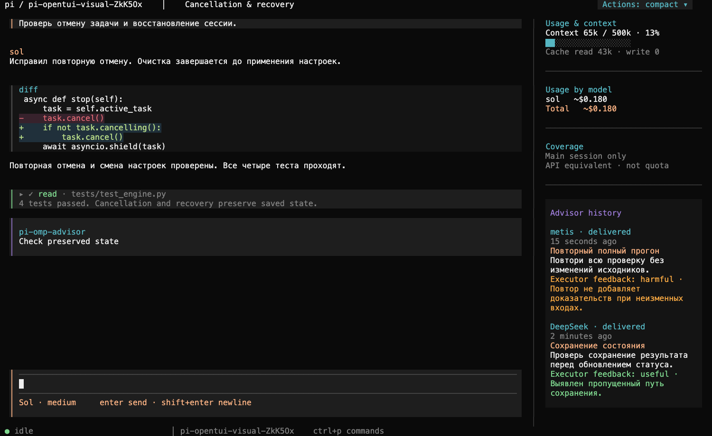

# pi-opentui

An experimental terminal interface for [Pi](https://github.com/earendil-works/pi), built with [OpenTUI](https://github.com/anomalyco/opentui). OpenCode-inspired colors and keyboard interactions, one scrolling sidebar, and your existing Pi sessions and configuration.

**Public alpha · 0.1.0-alpha.1.** The frontend runs real Pi through its SDK; it is not a fork of OpenCode, a new model provider, or an orchestration framework. No OmO installation is needed.



## Install

Requires **Node.js 26.4 or newer**, a terminal with true color, and internet access to install dependencies. OpenTUI's pinned dependency declares this Node minimum. An isolated Bun 1.4.4 runtime is installed with the package; no global Bun change is needed. Package installation scripts must be allowed for Bun's runtime setup.

For this alpha, download `pi-opentui-0.1.0-alpha.1.tgz` from the [GitHub release](https://github.com/arahisman/pi-opentui/releases/tag/v0.1.0-alpha.1), then:

```sh
npm install -g ./pi-opentui-0.1.0-alpha.1.tgz
pi-opentui --cwd /path/to/project
```

Or install from a checkout:

```sh
git clone https://github.com/arahisman/pi-opentui.git
cd pi-opentui
npm ci
node bin/pi-opentui.mjs --cwd /path/to/project
```

To add `/opentui` to an existing compatible Pi installation:

```sh
pi install /absolute/path/to/pi-opentui
```

Run `/opentui` at an idle boundary to hand the current session to the frontend. Exiting returns the saved session to native Pi. Installing this package does not automatically replace Pi's interface. The alpha pins **Pi SDK 1.5.2 and OpenTUI 0.8.4**; compatibility with other Pi versions is not promised.

## Use your Pi setup

By default, the frontend uses `~/.pi/agent`: existing model providers, login credentials, skills, MCP configuration and extension packages. You choose and authorize providers yourself; no subscriptions, API keys, extra skills or private plugins are bundled. A fresh configuration needs a model/provider login before sending a prompt. UI navigation itself makes no model request.

```sh
pi-opentui --continue
pi-opentui --session /path/to/session.jsonl
pi-opentui --agent-dir /path/to/isolated-agent --cwd /path/to/project
pi-opentui --clean
```

`--clean` disables optional installed extensions for this frontend run without rewriting settings. Session history stays owned by Pi. Frontend preferences, drafts and scroll anchors live separately under `<agent-dir>/pi-opentui`.

## What is included

- Full-screen conversation, Markdown/code/diff rendering and compact tool previews.
- Searchable commands, model selection, session history and branch navigation.
- Native Pi extension dialogs and custom-renderer bridging.
- Context indicator, usage by model and session-scope labels.
- A scrolling sidebar that becomes an overlay in narrow terminals.
- Newest-first advisor history with relative ages and persistent voluntary usefulness ratings from the executor.
- Copy-on-release selection, preserved while background updates arrive.
- Staged Preferences with Apply, connection information and local display settings.

### Optional integrations

Plain Pi works without these modules. Their absence is displayed as unavailable rather than silently installing anything.

| Integration | With an installed compatible module | Without it |
|---|---|---|
| Detailed usage journal | Reported subagent/advisor/compaction requests and per-model accounting | Pi's native main-session totals, explicitly labeled |
| Advisor | Delivered/pending notes and history | No advisor is started or provided by this package |
| Subagents | Existing extension commands; supported role/concurrency preferences | No orchestration engine is bundled |
| LSP / MCP | Existing native or extension connection information | Only actual available connections are shown |

When advice is delivered, the main agent can voluntarily use `advisor_feedback` to list delivered notes and rate one as useful or harmful with a short reason. Ratings are stored as session entries and shown in Advisor History; they are utility judgments, not proof of correctness or acceptance. Unrated notes stay unmarked, and the UI-local reviewed marker remains separate. The frontend does not force an extra review turn for every note.

Some Preferences adapters currently recognize specific local-checkout layouts: `<agent-dir>/local-packages/subagents`, `advisor` and `experiment`. They are optional compatibility adapters, not generally supported public plugin APIs. Custom compaction controls additionally require the default Pi agent directory. Other plugin layouts may work through their own commands while these Preferences sections remain unavailable.

Dollar amounts are estimates at configured API prices, **not subscription quota or invoices**. Native totals are not added to journal totals. Missing usage/prices remain explicit, and a running total may lag while records are being written. Detailed diagnostics are available in the usage view rather than occupying the sidebar. Removed context tokens alone do not prove monetary savings.

## Keyboard

| Action | Shortcut |
|---|---|
| Commands | Ctrl+P |
| Send / select | Enter |
| New line | Shift+Enter or Ctrl+Enter, when the terminal distinguishes it |
| Clear nonempty input | Ctrl+C |
| Queue steering message | Alt+Enter |
| Cancel work / close overlay | Escape |
| Model / sessions / new session / sidebar / connections | Ctrl+X then M / L / N / B / S |
| Expand tools / toggle thinking | Ctrl+O / Ctrl+T |
| Scroll / return to latest | PageUp, PageDown / Ctrl+End |
| Exit with empty input | Ctrl+D |

The top-right Actions control switches between collapsed, compact and full tool output. Ctrl+X dims the composer while waiting for the second key. Selection copies on mouse release through terminal OSC 52 support; terminal/host clipboard policy can affect availability. Native extension dialogs may retain their own navigation keys.

## Alpha limitations

- Validated locally on **macOS arm64**. Linux and Windows are not yet verified; Windows PTY behavior needs separate testing.
- The package pins SDK internals for some native UI adapters. SDK upgrades require compatibility checks.
- Existing extensions can execute code with your user account's permissions. This frontend is not a security sandbox.
- It requires an interactive terminal. Use native Pi for print/JSON/RPC automation.
- The VS Code sidebar wrapper used during development is a separate local extension and is not included. Run this package in a terminal or VS Code's integrated terminal.
- External provider uptime, subscription limits, embeddings, remote MCP services and notification delivery are not release-tested. Offline tests do not establish live service compatibility.

## Development and checks

```sh
npm ci
npm run typecheck
npm test
npm run pack:check
npm run verify:package
```

PTY tests require Python 3 and a supported Node in PATH, or `PI_OPENTUI_TEST_NODE` pointing to its executable. `verify:package` installs the packed archive in a temporary isolated home, checks extension discovery and real PTY launch/resize/exit and native Pi handoff, then removes its temporary installation. It downloads dependencies but uses no provider credentials or paid model calls. When Node is outside a normal installation layout, set `PI_OPENTUI_TEST_NPM` to the npm CLI script.

Visual checks use actual OpenTUI terminal-cell captures rasterized with Playwright and an installed Google Chrome:

```sh
./node_modules/.bin/bun scripts/capture-ui.ts
```

See [release verification](docs/RELEASE.md). Local generated logs and captures are ignored by Git and excluded from the npm archive. Some installed-module tests run only when their optional module is present.

## License and credits

MIT. Built on Pi and OpenTUI. The dark palette is derived from OpenCode; attribution and its MIT notice are in [THIRD_PARTY_NOTICES.md](THIRD_PARTY_NOTICES.md). This is an independent community project, not an official Pi, OpenCode or Anthropic release. No extracted Claude Code skills are included.
